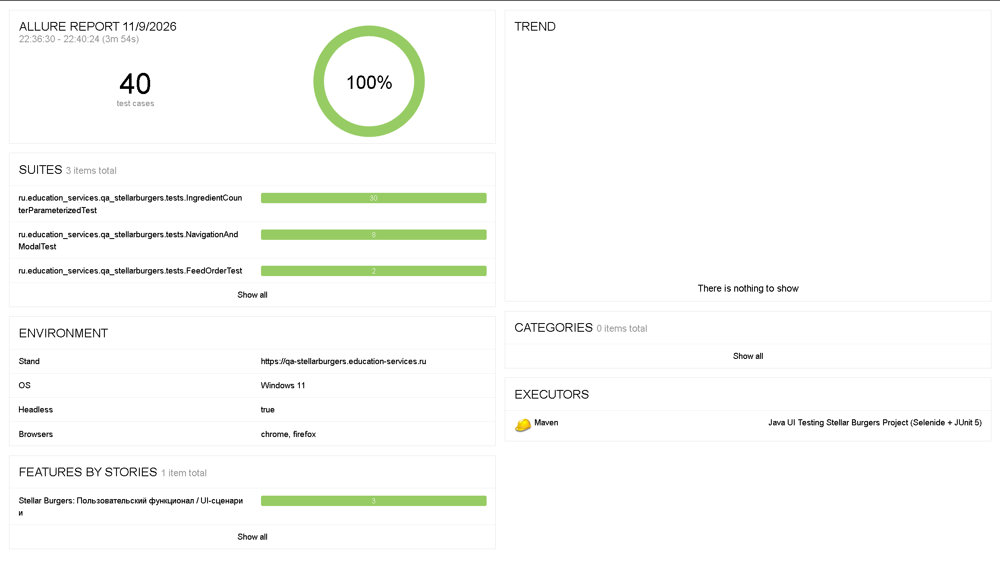
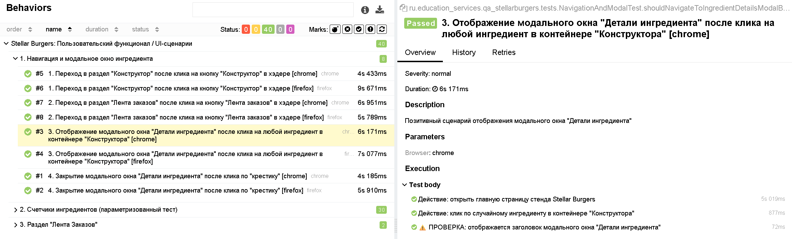
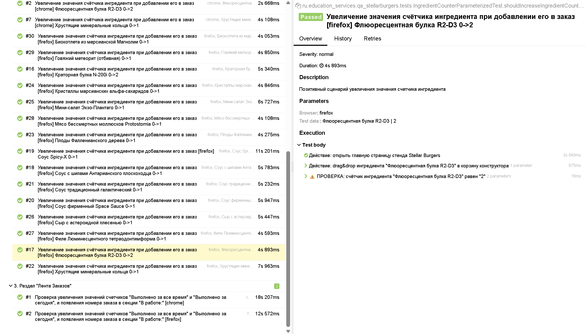
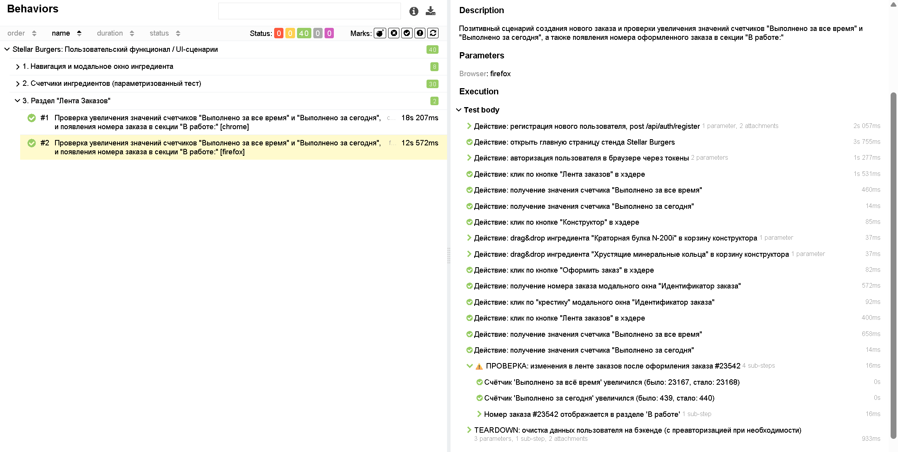

# UI-автотесты для веб-приложения Stellar Burgers (Selenide + JUnit 5)

Автоматизированный набор кроссбраузерных end-to-end UI-тестов для учебного сервиса космической бургерной **Stellar Burgers**. Проект построен на стеке **Java 11 + JUnit 5 + Selenide + RestAssured + Allure** с акцентом на стабильность прогонов, разделение ответственности и информативность отчётов.

---

## Технологический стек

* **Язык и сборка:** Java 11, Apache Maven
* **Тестовый фреймворк:** JUnit 5 (`TestTemplate`, `ParameterResolver`, `BeforeEachCallback` / `AfterEachCallback`)
* **UI-автоматизация:** Selenide 6.19.1 (Fluent Page Object, `DragAndDropOptions`)
* **API-слой для подготовки данных:** RestAssured + Gson + Datafaker
* **Отчётность:** Allure Framework (`allure-junit5`, `allure-selenide`, `allure-rest-assured`, `AllureEnvironmentListener`)
* **Утилиты:** Lombok

---

## Архитектурные особенности проекта

1. **Единый кроссбраузерный запуск (`@CrossBrowserTest`):**
    * Реализована собственная аннотация `@CrossBrowserTest` поверх JUnit 5 `@TestTemplate` (`CrossBrowserProvider`).
    * Каждый тест автоматически выполняется в заданном списке браузеров (по умолчанию **Chrome** и **Firefox**).
    * `CrossBrowserProvider` поддерживает совместную работу с `@CsvSource` (перемножая браузеры на наборы тестовых данных) и разделяет `historyId` / `fullName` в Allure, чтобы разные браузеры и параметры не склеивались в `Retries`.

2. **Fluent Page Object & Modal Objects:**
    * Логика страниц (`MainPage`, `FeedOrderPage`) и модальных окон (`IngredientDetailsModal`, `OrderCreatedModal`) разделена по классам.
    * Переходы между страницами и модалками возвращают соответствующий Page Object, позволяя описывать сценарии в виде читаемых цепочек вызовов.
    * Динамические локаторы инкапсулированы внутри Page Object через строковые шаблоны и приватные хелперы без хардкода селекторов в тестах.

3. **Гибридная подготовка тестовых данных (API + инъекция в `localStorage`):**
    * Для сценариев, требующих авторизации, пользователь создаётся напрямую через `POST /api/auth/register` (`UserClient`) с генерацией уникальных данных (`UserDataGenerator`).
    * Полученные `accessToken` и `refreshToken` записываются напрямую в `localStorage` браузера (`MainPage.authorizeWithTokens`), минуя UI-форму входа.
    * После завершения теста пользователь гарантированно удаляется через `DELETE /api/auth/user` в блоке `@AfterEach` (`UserTeardownSteps`).

4. **Разграничение `Failed` и `Broken` в отчётности (`WaitUtils`):**
    * Технические ожидания предусловий (загрузка списка ингредиентов из API, скрытие стартового оверлея, ожидание присвоения реального номера заказа вместо заглушки `9999`) обёрнуты в `WaitUtils.waitForPrecondition(...)`.
    * При сбоях стенда или таймаутах рендера тест маркируется в Allure как `Broken` (инфраструктурная проблема), а статус `Failed` остаётся исключительно для реальных проверок бизнес-логики (`⚠️ ПРОВЕРКА`).

5. **Детализированные отчёты Allure:**
    * Динамическое формирование файла `environment.properties` при каждом прогоне (`AllureEnvironmentListener`) с фиксацией URL стенда, списка браузеров, режима `headless`, ОС и версии Java.
    * Группировка проверок через `Allure.step` + JUnit `assertAll` для полной диагностики всех последствий оформления заказа за один проход.
    * Автоматическое прикрепление скриншотов и исходного кода страницы только при падении тестов (без технического шума в успешных шагах).

---

## Структура проекта

```text
src/test/java/ru/education_services/qa_stellarburgers/
├── api/
│   ├── client/          # RestAssured-клиенты (BaseClient, UserClient)
│   ├── data/            # Генерация тестовых данных на базе Datafaker (UserDataGenerator)
│   ├── models/          # POJO-модели запросов и ответов API (request / response)
│   └── steps/           # Вспомогательные API-шаги очистки данных (UserTeardownSteps)
├── config/              # Конфигурация стенда и параметров запуска (AppConfig)
├── extension/           # Расширения JUnit 5 и Allure (@CrossBrowserTest, SelenideExtension, AllureEnvironmentListener)
├── pageobject/          # Page Object и Modal Object (MainPage, FeedOrderPage, IngredientDetailsModal, OrderCreatedModal)
├── tests/               # Тестовые наборы (NavigationAndModalTest, IngredientCounterParameterizedTest, FeedOrderTest)
└── utils/               # Утилиты для работы с ожиданиями предусловий (WaitUtils)
```

---

## Покрытые тестовые сценарии

* **`NavigationAndModalTest`** — навигация и работа модального окна ингредиента:
    * Переход в раздел «Конструктор» по клику в хедере.
    * Переход в раздел «Лента заказов» по клику в хедере.
    * Открытие модального окна «Детали ингредиента» при клике на случайную карточку ингредиента.
    * Закрытие модального окна кликом по крестику.
* **`IngredientCounterParameterizedTest`** — работа конструктора бургеров (параметризованный прогон через `@CsvSource`):
    * Перетаскивание ингредиентов всех категорий (булки, соусы, начинки) в корзину конструктора (`Drag-and-Drop`).
    * Проверка корректного увеличения счётчика добавленного ингредиента (`+2` для булок, `+1` для соусов и начинок).
* **`FeedOrderTest`** — сквозной E2E-сценарий оформления заказа и обновления «Ленты заказов»:
    * Фиксация исходных значений счётчиков «Выполнено за всё время» и «Выполнено за сегодня».
    * Сборка бургера из ингредиентов, оформление заказа и получение присвоенного номера из модального окна.
    * Комплексная проверка (`assertAll`) увеличения обоих счётчиков и появления номера созданного заказа в разделе «В работе:».

---

## Запуск тестов и генерация отчёта

### Требования
* Установленная **JDK 11** и **Apache Maven 3.8+**
* Установленные браузеры **Google Chrome** и **Mozilla Firefox** (драйверы подтягиваются автоматически через Selenium Manager)

### Команды запуска

* **Полный кроссбраузерный прогон (Chrome + Firefox):**
  ```bash
  mvn clean test
  ```

* **Запуск в одном браузере и в headless-режиме (удобно для CI):**
  ```bash
  mvn clean test -Dbrowsers=chrome -Dheadless=true
  ```

* **Запуск отдельного тестового класса:**
  ```bash
  mvn test -Dtest=FeedOrderTest
  ```

* **Запуск конкретного тестового метода (в PowerShell / Windows):**
  ```powershell
  mvn test '-Dtest=shouldTotalAndTodayCountersIncreaseAndOrderNumberAppearIntoOrderInWorkSection'
  ```

* **Сборка и открытие отчёта Allure в браузере:**
  ```bash
  mvn allure:serve
  ```

### Доступные системные свойства (`-D`)

| Параметр | Описание | Значение по умолчанию           |
| :--- | :--- |:--------------------------------|
| `baseUrl` | Базовый URL тестируемого стенда | `https://education-services.ru` |
| `browsers` | Список браузеров через запятую (`chrome`, `firefox`) | `chrome,firefox`                |
| `headless` | Запуск браузеров без графического интерфейса (`true` / `false`) | `false`                         |
| `timeout` | Таймаут ожидания элементов Selenide (в миллисекундах) | `20000`                         |

## 📊 Пример отчёта Allure

### Общая сводка прогона и динамический блок Environment (`Overview`)


### Открытие модального окна «Детали ингредиента» (`Chrome`)


### Параметризованная проверка счётчика ингредиента при добавлении в корзину (`Firefox`, `@CsvSource`)


### E2E-проверка ленты заказов и вложенных шагов `assertAll` (`Firefox`)

